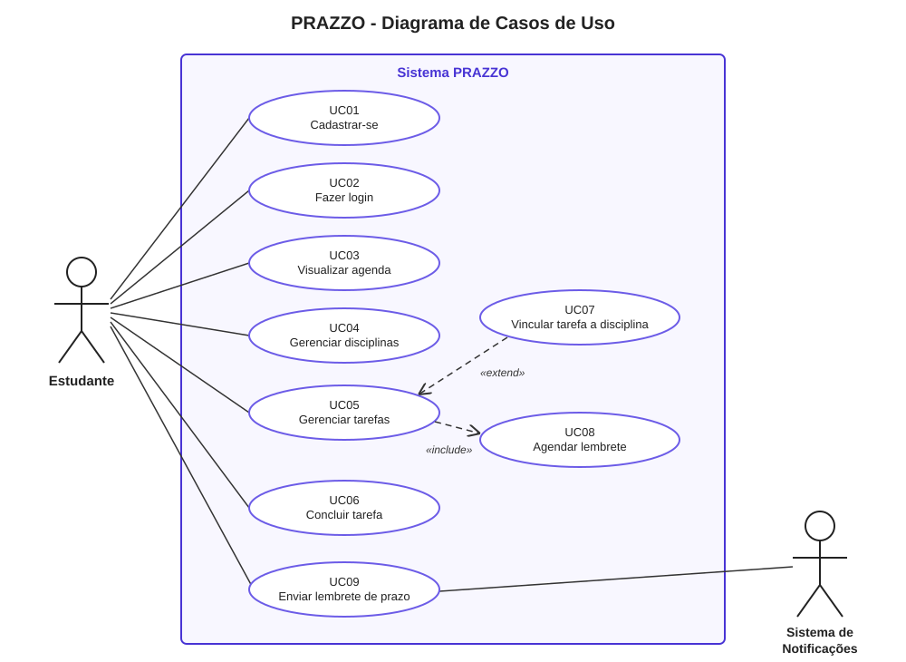

# Diagrama de Casos de Uso - PRAZZO

## Atores

| Ator | Tipo | Descrição |
| ---- | ---- | --------- |
| **Estudante** | Primário | Usuário do app. Organiza disciplinas, tarefas e prazos. |
| **Sistema de Notificações** | Secundário | Serviço que, no horário agendado, dispara os lembretes de prazo. |

## Casos de uso

| ID | Caso de uso | Ator(es) | Descrição | Situação |
| -- | ----------- | -------- | --------- | -------- |
| UC01 | Cadastrar-se | Estudante | Cria a conta informando nome, RA, e-mail e senha. | Implementado (tela + `POST /auth/registrar`) |
| UC02 | Fazer login | Estudante | Entra com e-mail e senha e recebe um token JWT. | Implementado (tela + `POST /auth/login`) |
| UC03 | Visualizar agenda | Estudante | Vê no painel as tarefas ordenadas por prazo. | Tela pronta (dados mock) |
| UC04 | Gerenciar disciplinas | Estudante | Cadastra, edita e exclui disciplinas (nome, código, cor). | Planejado (tabela `disciplinas`) |
| UC05 | Gerenciar tarefas | Estudante | Cria, edita e exclui tarefas (título, tipo, prioridade, prazo). | Planejado (tabela `tarefas`) |
| UC06 | Concluir tarefa | Estudante | Marca a tarefa como concluída ou cancelada. | Planejado (`tarefa_status`) |
| UC07 | Vincular tarefa a disciplina | Estudante | Associa, opcionalmente, a tarefa a uma disciplina. | Planejado (`tarefas.disciplina_id`) |
| UC08 | Agendar lembrete | - | Ao salvar uma tarefa, o sistema agenda o lembrete do prazo. | Planejado (tabela `notificacoes`) |
| UC09 | Enviar lembrete de prazo | Sistema de Notificações, Estudante | No horário agendado, o lembrete é enviado ao estudante. | Planejado |

## Relacionamentos

| Relação | De | Para | Por quê |
| ------- | -- | ---- | ------- |
| «include» | UC05 Gerenciar tarefas | UC08 Agendar lembrete | Toda tarefa salva **sempre** tem um lembrete agendado. |
| «extend» | UC07 Vincular tarefa a disciplina | UC05 Gerenciar tarefas | Vincular é **opcional**: a tarefa pode existir sem disciplina. |

**Pré-condição:** UC03 a UC07 exigem que o estudante esteja autenticado (UC02).

## Como desenhar no ArgoUML

1. **Arquivo > Novo** e depois **Criar > Novo Diagrama de Casos de Uso**.
2. Na barra do diagrama, use **Novo Ator** para criar `Estudante` e `Sistema de Notificações`.
3. Use **Novo Caso de Uso** para cada linha da tabela acima (UC01 a UC09).
   Renomeie no painel de propriedades (parte de baixo da tela).
4. Use **Nova Associação** para ligar cada ator aos seus casos de uso, conforme a coluna "Ator(es)".
5. Use **Novo Include**: clique em `Gerenciar tarefas` e arraste até `Agendar lembrete`.
6. Use **Novo Extend**: clique em `Vincular tarefa a disciplina` e arraste até `Gerenciar tarefas`.
7. Para a fronteira do sistema, use a ferramenta **Retângulo** e escreva "Sistema PRAZZO".
8. Salve como `docs/diagramas/casos-de-uso.zargo` e exporte em
   **Arquivo > Exportar Gráficos** como PNG para ver no GitHub.
